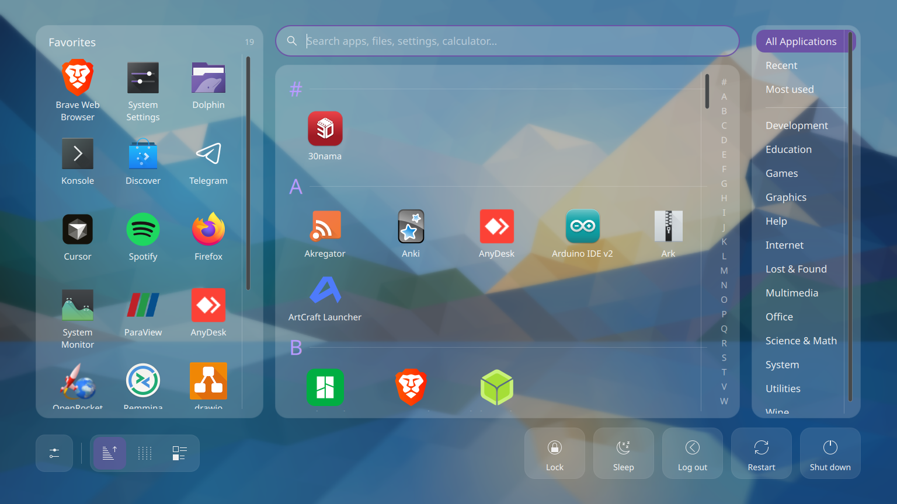
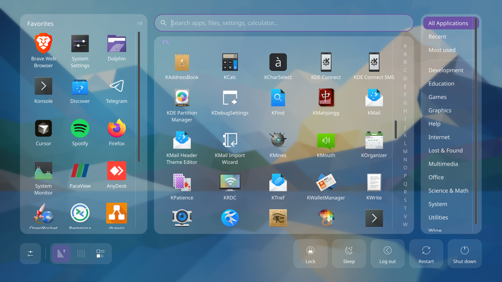
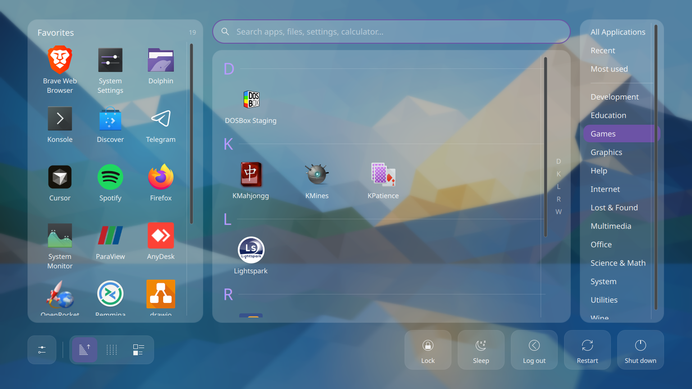
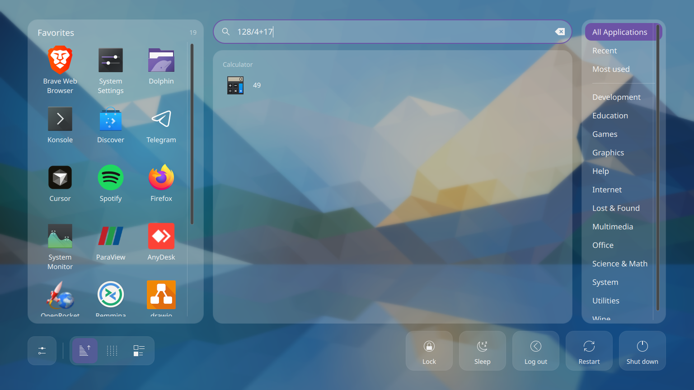
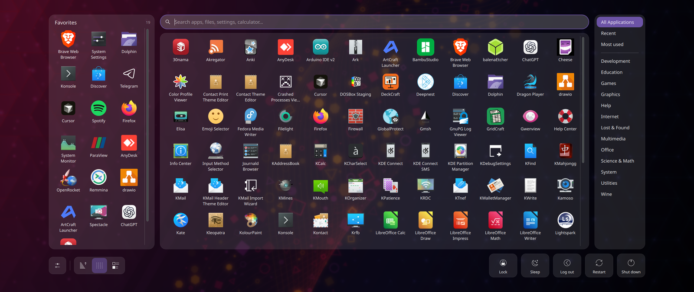
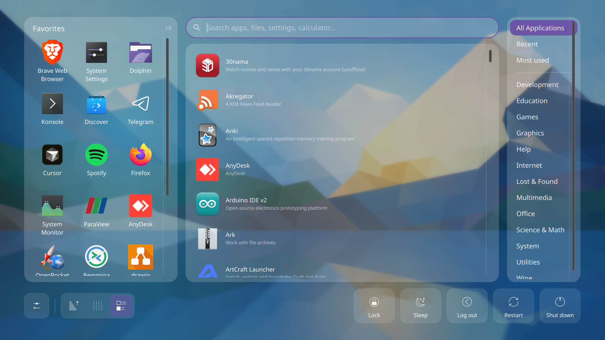
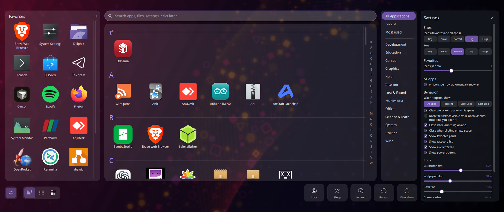
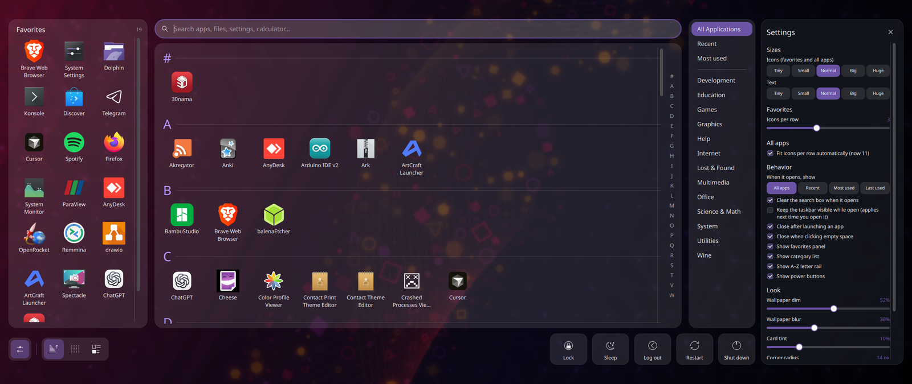
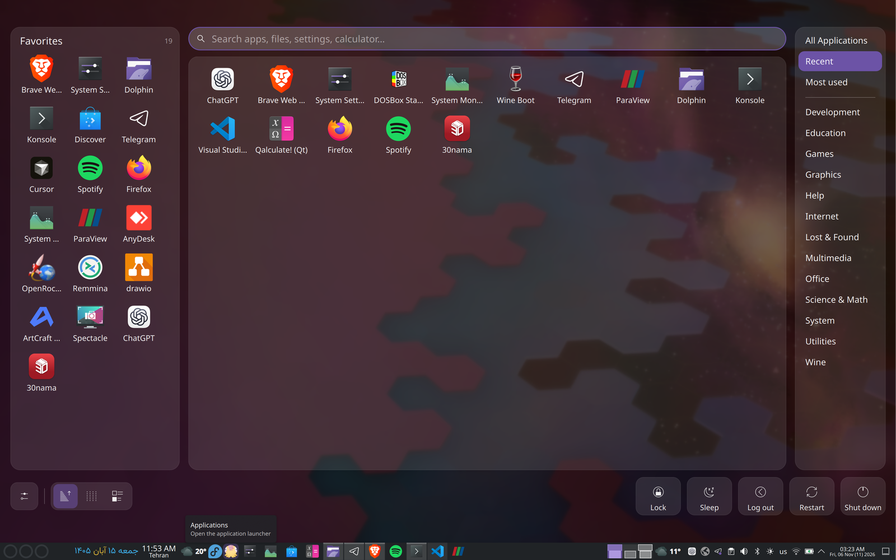

<div align="center">

# Dara Launcher

**A fast, full-screen application launcher for KDE Plasma 6**<br>
dimmed wallpaper · scrollable favorites · A–Z sections · categories on the right · live settings

[](https://kde.org/plasma-desktop/)
[](https://doc.qt.io/qt-6/qtqml-index.html)
[](#testing)
[](LICENSE)


</div>

Plasma's own full-screen dashboard shows a short, fixed list of favorites and one long list of apps. Dara Launcher keeps
what works about it and rebuilds the rest: your **wallpaper** (dimmed, optionally blurred) behind the apps, **as many
favorites as you like** in a scrollable column, **every app grouped under big letters**, a **category column**, a
**search that doubles as a calculator**, and a **settings drawer that changes the launcher while you watch**.

<div align="center">
  
</div>

## Contents

- [Features](#features)
- [Screenshots](#screenshots)
- [Install](#install)
- [Using it](#using-it)
- [Settings](#settings)
- [Keep the taskbar visible](#keep-the-taskbar-visible)
- [How it works](#how-it-works)
- [Testing](#testing)
- [Repository layout](#repository-layout)
- [Privacy](#privacy)
- [Known limits](#known-limits)
- [Credits and license](#credits-and-license)

## Features

**Layout**
- **Favorites on the left**, in as many columns as you want (3 by default), **scrollable with no slot limit**. Right-click to add, remove or move.
- **Opens instantly**: no fade, no popup, no icon flash: a keypress on Meta shows the finished launcher.
- **Instant search on top**: type anywhere to start. Apps are matched in memory on every keystroke (about 40 µs for 114 apps), so the list updates in the same frame as the key press. It understands prefixes, later words, **initials** (`vsc` → Visual Studio Code), **fuzzy letters** (`dlp` → Dolphin) and several words (`sys sett`). KRunner results (settings pages, files, bookmarks, the calculator: `128/4+17` → `49`, unit conversion) are merged in below as they arrive, and never delay the apps. Prefer apps only? Turn off **Also search documents…** in the settings and KRunner is never queried.
- **Categories on the right**, in a column exactly as wide as its longest name. *All Applications*, *Recent* and *Most used* are kept apart from the real categories by a divider.
- **Three ways to browse** all apps: **A–Z sections** with big letter headings and a clickable A–Z rail (default), a **grid**, or a **one-column list** with descriptions.
- **App names are always shown in full.** Long names wrap (even inside a long word) and each row grows to fit its longest name; nothing is ever cut with “…”. Category names and power-button labels are never clipped either.
- **Big, labelled power buttons** — Lock, Sleep, Log out, Restart, Shut down — aligned to the edges of the cards.

**Look**
- Your **current desktop wallpaper**, dimmed and blurred (both adjustable), or any image you choose.
- Frosted-glass cards, your Plasma accent color (or a custom one), your font (or any installed one).
- **Icon size and text size are simple presets**: *Tiny, Small, Normal, Big, Huge* — the same icon size for favorites and all apps.

**Behavior**
- **Choose what it opens on**: All apps, Recent, Most used, or whatever you used last.
- **Click far away to close.** Clicks near an app or button are treated as slips and ignored; only a click really far from everything closes it.
- **Keep the taskbar visible** if you like (see [below](#keep-the-taskbar-visible)).
- Full keyboard use: `↓` into the results, arrows to move, `Enter` to launch, `Esc` to clear, then close.

**Performance**
- Only the rows you can see exist (about 50 tiles for 114 apps), wallpaper blur is rendered once and cached, scrolling is smooth and fast on mouse, touchpad and touch.

## Screenshots

| | |
|:--:|:--:|
| <br>**A–Z sections**, scrolled | <br>**A category** (Games) |
| <br>**Search**: the calculator answers inline | <br>**Grid** view |
| <br>**List** view: one column, with descriptions | <br>**Big** icons, chosen live in the settings drawer |

<div align="center">
  <br>
  <sub>The settings drawer: the launcher stays visible and changes as you move the controls.</sub>
</div>

## Install

**Requirements:** KDE Plasma 6 (developed on 6.7, Wayland), `kpackagetool6`, and `python3` (used only to find your wallpaper).

```sh
git clone https://github.com/DaraSamii/DaraLauncher.git
cd DaraLauncher
./install.sh
```

Then right-click the panel → **Add Widgets…** → search **Dara Launcher** and drop it on your taskbar. Click the button to open the launcher.
If it does not appear in the list, restart the shell once: `plasmashell --replace &`.

To remove it: take the widget off the panel, then `./uninstall.sh`.

Pick the button's icon (any theme icon or your own image) under **right-click → Configure → Panel & wallpaper**.
**Meta (Super) key:** Dara Launcher declares itself an *Application Launcher* (`X-Plasma-Provides: org.kde.plasma.launchermenu`, category *Application Launchers*, exactly like Plasma's own Kickoff and Application Dashboard), so the Meta key opens it directly: it appears at once, with no popup and no animation. With several launcher widgets installed Plasma picks the first it finds, so keep one. You can also assign any shortcut on the widget's **Keyboard Shortcuts** page (right-click → Configure).

## Using it

| You do | It does |
|---|---|
| Click the panel button | Opens the launcher |
| Just start typing | Searches (apps, settings, files, calculator) |
| `↓` from the search box | Moves into the results / grid; arrows move, `Enter` launches |
| `Enter` in the search box | Launches the first result |
| `Esc` | Clears the search → closes the settings drawer → closes the launcher |
| Click an app | Launches it and closes the launcher |
| Right-click an app | Open · Add/Remove favorite · Move earlier/later · the app's own actions (new window, …) |
| Click a letter in the A–Z rail | Jumps to that section |
| Mouse wheel / touchpad / touch | Smooth scrolling in every list |
| Click really far from anything | Closes the launcher (near misses are ignored) |

## Settings

Open the **gear** at the bottom left: a drawer slides in from the right while the launcher stays on screen, so every change is visible immediately. Right-click the panel button → **Configure** has the same options in a regular dialog (plus the panel icon and the wallpaper picker).

| Group | Options |
|---|---|
| **Sizes** | Icon size and text size: Tiny · Small · Normal · Big · Huge |
| **Favorites** | Icons per row (1–6) |
| **All apps** | Fit icons per row automatically, or fix the number (1–14) |
| **Behavior** | What to show on open (All apps / Recent / Most used / Last used) · **search scope: apps only, or documents, files, settings and the calculator too** · clear search on open · close after launching · close when clicking far away · keep the taskbar visible · show favorites · show category list · show A–Z rail · show power buttons |
| **Look** | Wallpaper dim and blur · card tint · corner radius · power button size |
| **Configure dialog only** | Panel icon · wallpaper source (current / custom image / none) · font family · accent color · animations · tile spacing · launcher width · show *Recent* / *Most used* categories |

Settings are stored per widget, so two launchers on two panels can look different.

## Keep the taskbar visible

By default the launcher covers the whole screen, taskbar included. Turn on **Keep the taskbar visible** (drawer → Behavior) and it sizes itself to the screen *minus your panel*, whichever edge the panel is on, so the taskbar stays visible and clickable:

<div align="center">
  
</div>

In this mode the launcher closes by itself when you **open an app, switch to another app's window, or change desktop** from the taskbar. Small plasmoid popups (clock, volume, tray, …) are not windows of apps, so they leave it open. The window is sized *before* it is shown, so the panel is never covered, not even for a frame.

## How it works

- It is a **Plasma 6 applet** written in QML on top of Plasma's own `org.kde.plasma.private.kicker` models: the same application menu, favorites storage (KActivities), recent/frequent usage and KRunner search that Kickoff uses, so favorites and usage statistics behave exactly like the stock launcher's.
- The all-apps list is a **virtualised list of rows** (one heading or one line of tiles per row), so only what is on screen is instantiated; tiles are plain items with no layouts, per-tile animations or tooltip objects, and font objects are cached.
- The wallpaper (downsized when blurred) sits in a **cached layer**: the blur is computed once, not every frame. The panel only fades in; it never resizes or scales while you interact.
- Search never waits: apps are matched synchronously from an in-memory index and the result rows re-bind in place (no list rebuild per keystroke); KRunner is queried 20 ms after you stop typing, pre-warmed once in the background, and merged in as it answers. List rebuilds elsewhere are batched; nothing runs while the launcher is closed.
- The wallpaper path is read from your Plasma configuration by a tiny helper (`contents/code/wallpaper.py`) each time the launcher opens, so slideshows keep working.
- Power actions use the standard Plasma logout prompt (`org.kde.LogoutPrompt`), `loginctl lock-session` and `systemctl suspend`.

## Testing

A launcher is the front door of the desktop, so it ships with an **end-to-end test suite that drives the real UI** with synthetic mouse, wheel and keyboard events:

```sh
./tests/run.sh               # everything (about 90 seconds)
./tests/run.sh "scrolling"   # only tests whose name contains the text ("a|b" for several)
```

It copies the package to a **sandbox plugin id** (your real widget and settings are untouched), replaces app launching and power actions with recorders (nothing is ever started, nothing is ever shut down), and runs the launcher in `plasmawindowed`. a few hundred checks across about 35 scenarios, covering:

- every button, view mode and category, with the effect verified, not just "the click happened";
- the settings drawer: all presets, every slider, every checkbox, the start-category chips, *Reset sizes*, and that each option really shows or hides its part of the UI;
- search (typing, ranking, the clear button, `Enter`), keyboard navigation, tile launching, the context menu (add/remove favorite), the five power buttons;
- click-away behavior: near misses stay open, far clicks close, the option can disable it;
- **launcher integration**: declared as an application launcher (the Meta-key target) and no full-representation popup in a panel (static checks);
- the taskbar mode: desktop change and new app close it, a popup window does not;
- scrolling (exact wheel distances, the A–Z rail), layout alignment invariants (power buttons identical and flush with the cards, gear aligned, columns in order), configuration schema consistency and that every config page compiles;
- **app names are whole**: every icon size × text size, in sections and grid views, scrolled through every row;
- **laptop screens**: at 1536 × 864 the apps area keeps at least two columns at every icon size, with and without the settings drawer;
- **instant search**: ranking, fuzzy / initials / multi-word matching, and the cost of a keystroke (matching ≈ 40 µs, whole handler < 1 ms, key press to painted frame ≈ one frame);
- performance budgets: regrouping time, first frame after opening, and scroll frame pacing (typically p95 ≈ 15–20 ms).

Static checks run first (`qmllint`, and a script that makes sure every setting the QML reads exists in the schema). Any QML **binding loop** or layout recursion logged during the run fails the suite.

`tools/media.sh` regenerates the screenshots and the demo GIF above by driving the same sandbox through a scripted tour.

## Repository layout

```
launcher/            the Plasma package (what gets installed)
  metadata.json
  contents/ui/       LauncherWindow, AppTile, SmoothScroll, CompactRepresentation, config pages
  contents/config/   settings schema (main.xml) and config dialog pages
  contents/code/     wallpaper.py
tests/               run.sh · Suite.qml · patch.py · static.py   (end-to-end suite)
tools/               media.sh · Demo.qml · make_gif.py            (screenshots and GIF)
docs/                images used by this README
install.sh  uninstall.sh
```

## Privacy

No network access, no telemetry. The launcher reads only your Plasma configuration file to find the wallpaper path, and uses the same local data (favorites, usage statistics, KRunner) as Plasma's stock launcher.

## Known limits

- **Meta key:** Plasma sometimes delivers one press as two activations a few hundred milliseconds apart, so the launcher ignores a second activation within 0.8 s of the first. Opening and closing it with two deliberate presses is unaffected.

- **Plasma only, and tied to its private API.** It builds on `org.kde.plasma.private.kicker`, which KDE may change between releases.
- Developed and tested on **Plasma 6.7 / Wayland**. X11 and other Plasma 6 versions are untested.
- *Keep the taskbar visible* takes away the panel the widget lives on; other panels on the same screen are not subtracted. It was tested with a bottom panel; top, left and right use the same logic but are untested.
- Touchpad and touch scrolling follow the standard Qt paths and are not covered by the automated tests (wheel scrolling is).
- Search results come from your KRunner configuration, so what appears (files, bookmarks, …) follows the runners you have enabled in System Settings.

## Credits and license

Released under the **[GNU General Public License v3.0](LICENSE)** © 2026 Dara Samii.
Screenshots use the *Altai* wallpaper by Alesya Khoteeva (CC-BY-SA-4.0) from KDE's default wallpapers, captured at laptop size (1536 × 864), and the Breeze icon theme.
Built on KDE Plasma, Qt Quick and Kirigami. Not affiliated with or endorsed by KDE.
